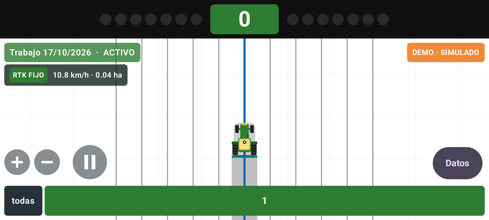
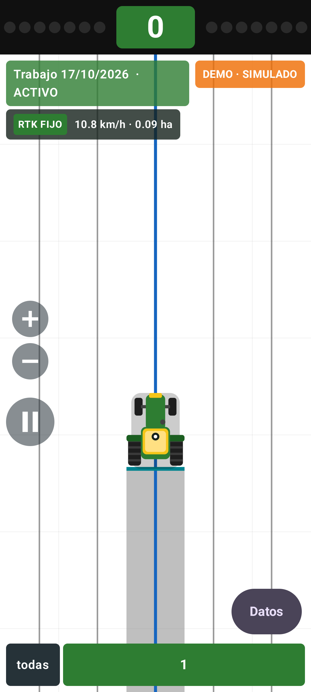
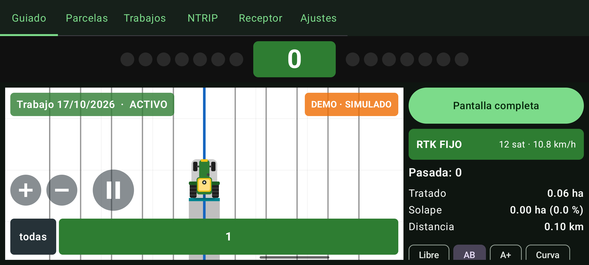

<p align="center">
  
</p>

# AgroGuide RTK

Aplicación Android libre de **guiado agrícola por GNSS-RTK**: guiado visual con barra de luces y vista de campo, pintado de la zona trabajada y del solape, parcelas, trabajos e informes. Pensada para un móvil o tablet en la cabina del tractor y un receptor RTK por Bluetooth (probada con el kit ArduSimple RTK Portable Bluetooth, u-blox ZED-F9P).

*Free (GPL-3.0) Android app for GNSS-RTK tractor guidance: lightbar + field view, real-time coverage and overlap painting, NTRIP client, fields, jobs and PDF reports. Spanish UI.*

> **Aviso:** es una ayuda visual al conductor, no un sistema de autoguiado. No controla la dirección del tractor. Úsala bajo tu responsabilidad y sin quitar la vista del terreno.

<p align="center">
  
  
</p>
<p align="center">
  
</p>

## Instalación

1. Descarga el APK de la última versión en **[Releases](../../releases)**.
2. Ábrelo en el móvil y permite "Instalar aplicaciones desconocidas" cuando Android lo pida.
3. Sigue el [manual de usuario (PDF)](docs/manual/AgroGuideRTK-Manual.pdf) para emparejar el receptor y configurar NTRIP.

Requiere Android 8.0 o superior.

## Qué hace

- **Posicionamiento:** receptor GNSS por Bluetooth SPP (parser NMEA propio, watchdog y reconexión automática), ubicación interna de Android o modo demo simulado sin hardware. Compensación automática del retardo del receptor (medido con la hora de cada posición) y dibujo a 30 fps.
- **Correcciones RTK:** cliente NTRIP v1/v2 integrado (perfiles, explorador de mountpoints ordenado por distancia, envío de GGA para redes VRS, prueba de conexión con el motivo real del rechazo del caster). El RTCM3 se envía al receptor por el mismo enlace Bluetooth.
- **Receptor u-blox:** botón "Optimizar" (5 Hz, GSV desactivado) vía UBX-CFG-VALSET con confirmación por ACK, y restaurar valores de fábrica.
- **Guiado:** líneas AB, A+, curvas grabadas y modo libre; desviación lateral con salto automático a la pasada más cercana; offsets del apero; barra de luces legible a 2 m.
- **Vista de campo:** orientación horizontal, vertical o automática; pantalla completa al iniciar un trabajo; zoom amplio con botones +/− y pausa sobre el campo; colores de fondo, zona trabajada y solape configurables; cuadrícula opcional; vehículo (mini tractor, triángulo o cuadrado) del ancho del apero; mapas base OpenStreetMap, satélite Esri o Google (con tu propia API key) con caché offline.
- **Cobertura:** pintado en tiempo real con solape en otro color, hasta 16 secciones manuales, contadores de hectáreas, solape y distancia. Opción de pausar el pintado al detenerse.
- **Parcelas:** creación conduciendo el perímetro o marcando puntos; área y perímetro; importación y exportación GeoJSON y KML.
- **Trabajos:** iniciar, pausar, reanudar y finalizar con un diario binario a prueba de cierres inesperados; **continuar** cualquier trabajo del histórico donde se dejó (cobertura, recorrido y línea de guiado); informes HTML y PDF del trabajo completo.
- **Robustez:** servicio en primer plano, ayuda para los gestores de batería de MIUI/EMUI/One UI, salida como proveedor de ubicación simulada para otras apps, tema día/noche.

## Compilar

Requisitos: Android Studio (incluye el JDK) y Android SDK 36.

```powershell
$env:JAVA_HOME = "C:\Program Files\Android\Android Studio\jbr"
.\gradlew.bat test assembleDebug
# APK: app\build\outputs\apk\debug\app-debug.apk
```

En Linux/macOS: `./gradlew test assembleDebug`.

La compilación `release` se firma solo si existe un `keystore.properties` local (no incluido en el repositorio); sin él se genera sin firmar. El tipo de compilación `beta` (`com.agroguide.rtk.beta`) se instala junto a la versión normal para hacer pruebas A/B.

## Arquitectura

| Módulo | Tipo | Contenido |
|---|---|---|
| `:core:geo` | JVM | Plano tangente ENU WGS84, filtro de saltos, proyector, motor de guiado (AB/A+/curvas, desviación, snap), retención de rumbo en paradas |
| `:core:nmea` | JVM | Parser NMEA 0183, agregador de fixes, UBX (VALSET, ACK), generador sintético para demo y tests |
| `:core:ntrip` | JVM | Cliente NTRIP v1/v2, sourcetable, clasificación de errores del caster |
| `:core:coverage` | JVM | Cobertura incremental por teselas con JTS (OverlayNG), solape, contadores |
| `:data` | Android | Room (parcelas, trabajos), diario de trabajo, GeoJSON/KML, informes HTML/PDF |
| `:device` | Android | Fuentes de posición (Bluetooth, Android, demo), pipeline, proveedor de ubicación simulada |
| `:service` | Android | Servicio en primer plano, repositorios de posición/guiado/cobertura, sesión NTRIP, gestor de trabajos |
| `:app` | Android | Interfaz Jetpack Compose |

Tests: `.\gradlew.bat test` (más de 150 tests JVM, sin dispositivo). El hardware se sustituye por el generador NMEA sintético.

Especificación y planes de implementación en `docs/superpowers/`.

## Contribuir

Los informes de errores y las mejoras son bienvenidos: abre un *issue* o un *pull request*. Para errores de campo ayuda mucho indicar el receptor, el caster NTRIP (sin credenciales) y el modelo de móvil.

## Licencia

Copyright (C) 2026 Moreta82

Este programa es software libre: puedes redistribuirlo y/o modificarlo bajo los términos de la **GNU General Public License versión 3** publicada por la Free Software Foundation. Se distribuye con la esperanza de que sea útil, pero **SIN NINGUNA GARANTÍA**. Consulta el fichero [LICENSE](LICENSE).

Los mapas base pertenecen a sus proveedores (© colaboradores de OpenStreetMap, Esri, Google) y su uso está sujeto a sus propias condiciones.
